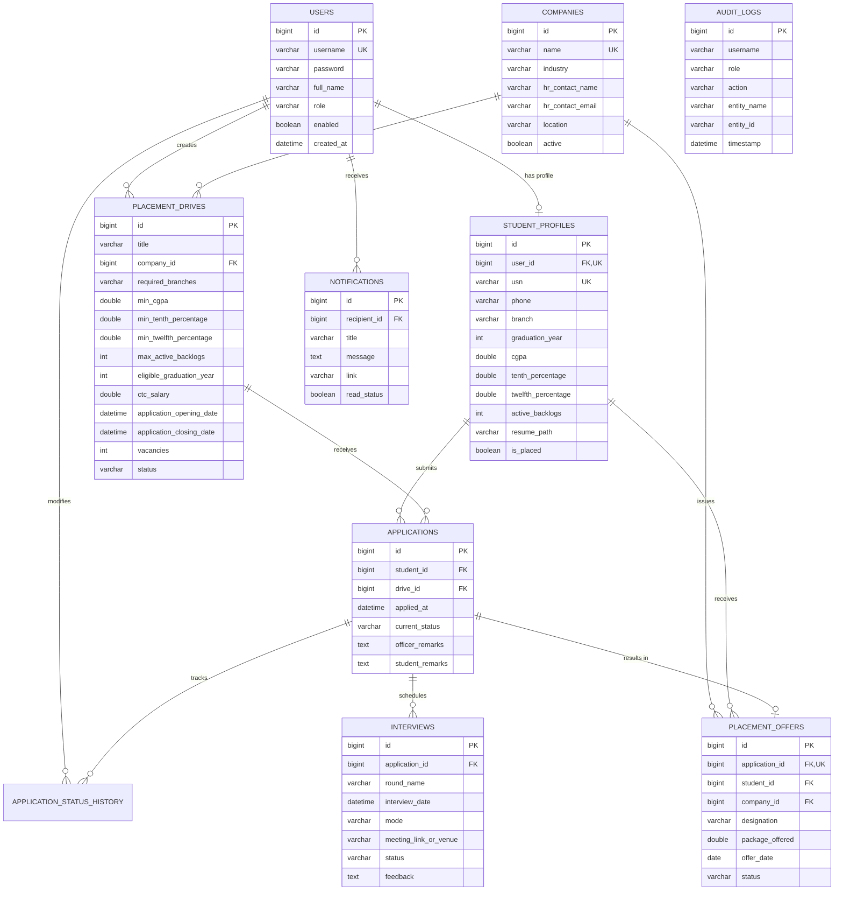
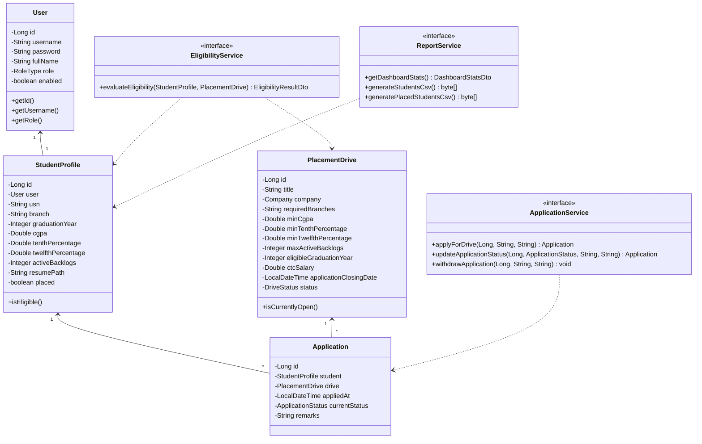
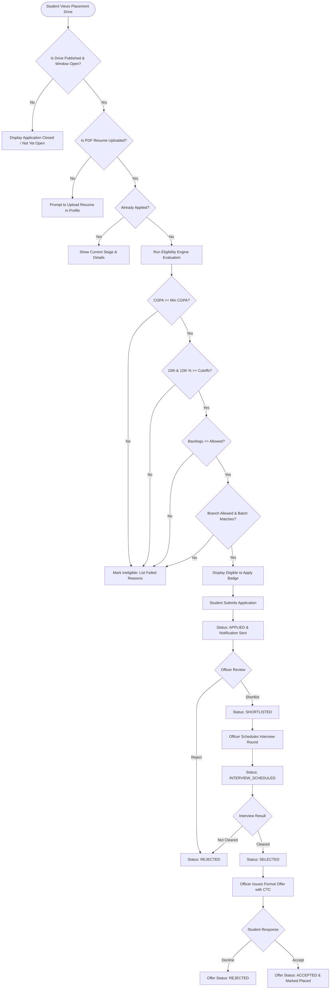

# College Placement Management System (CPMS)

An enterprise-grade, full-stack campus recruitment and placement portal developed with **Java 17/21**, **Spring Boot 3.3**, **Spring Security 6**, **Spring Data JPA / Hibernate**, **MySQL**, **Thymeleaf**, and **Bootstrap 5**. Engineered for final-year Computer Science & Engineering degree capstone submissions and campus recruitment automation.

---

## 1. System Architecture & Tech Stack

### Core Technologies
- **Backend Framework:** Spring Boot 3.3.4 (MVC Architecture)
- **Programming Language:** Java 17 / 21 LTS
- **Security & Authorization:** Spring Security 6 (Role-Based Access Control, BCrypt password hashing, CSRF protection)
- **Persistence & ORM:** Spring Data JPA, Hibernate 6
- **Database Engine:** MySQL 8.x (with zero-config embedded H2 in MySQL compatibility mode for development)
- **Presentation Layer:** Thymeleaf 3, HTML5, CSS3, JavaScript (ES6+), Bootstrap 5.3.3, Chart.js 4.4
- **Data Interchange & Reporting:** Apache Commons CSV (RFC 4180 export), Multipart PDF file storage
- **Testing Suite:** JUnit 5, Mockito, Spring Security Test, Spring Boot Test (24 automated test cases)
- **Build Tool:** Apache Maven 3.9+

### Architecture Overview
The application follows a clean 4-tier enterprise architecture:
1. **Presentation Layer:** Thymeleaf server-side templates with responsive Bootstrap 5 components and Chart.js dynamic canvases.
2. **Controller Layer:** Thin Spring MVC controllers handling HTTP requests, view resolution, request parameter validation, and user role redirection.
3. **Service Layer:** Transactional business logic orchestrating the **Automatic Eligibility Engine**, application state transitions, file validation, notification dispatch, and audit logging.
4. **Data Access Layer:** Spring Data JPA repositories with parameterized queries, entity lifecycle hooks (`@PrePersist`, `@PreUpdate`), and indexed database relationships.

```
       +-------------------------------------------------------------+
       |                     Client Web Browser                      |
       +-------------------------------------------------------------+
                                      | HTTP / HTTPS
                                      v
       +-------------------------------------------------------------+
       |                    Spring Security Filter                   |
       |  (Authentication, Role Checks, CSRF, Session Management)    |
       +-------------------------------------------------------------+
                                      |
         +----------------------------+----------------------------+
         |                            |                            |
         v                            v                            v
  [AdminController]          [OfficerController]          [StudentController]
         |                            |                            |
         +----------------------------+----------------------------+
                                      |
                                      v
                   +------------------------------------+
                   |           Service Layer            |
                   | - EligibilityService (Gatekeeper)  |
                   | - ApplicationService (Lifecycle)   |
                   | - InterviewService (Scheduling)    |
                   | - ReportService (Analytics & CSV)  |
                   | - NotificationService (Alerts)     |
                   | - AuditLogService (Compliance)     |
                   +------------------------------------+
                                      |
                                      v
                   +------------------------------------+
                   |     Spring Data JPA Repositories   |
                   +------------------------------------+
                                      |
                                      v
                   +------------------------------------+
                   |          MySQL Database            |
                   +------------------------------------+
```

---

## 2. User Roles & Access Control

| Role | Permissions & Functional Scope | Default Credentials |
| :--- | :--- | :--- |
| **Administrator** (`ROLE_ADMIN`) | System overview, student database management (search/activate/deactivate), recruiting partner registration, placement drive deletion, CSV reports export, and administrative audit inspection. | `admin@college.edu` / `Admin@123` |
| **Placement Officer** (`ROLE_OFFICER`) | Drive authoring & publishing, candidate application pipeline management, interview round scheduling, offer letter issuance, and campus-wide notice broadcast. | `officer@college.edu` / `Officer@123` |
| **Student** (`ROLE_STUDENT`) | Self-registration, academic profile maintenance (CGPA, 10th/12th %, backlogs), PDF resume upload, automatic drive eligibility checking, application submission, application tracking, interview schedule viewing, and offer acceptance/rejection. | `rahul.sharma@college.edu` / `Student@123` |

---

## 3. Database ER Diagram

The normalized relational database schema consists of 10 interconnected tables:



---

## 4. UML Class Diagram



---

## 5. Application Workflow



---

## 6. Automatic Eligibility Engine Specification

The `EligibilityService` is a standalone, deterministic business engine responsible for verifying student qualifications against corporate drive thresholds.

### Evaluation Rules & Boundary Conditions
1. **CGPA Comparison:** `student.getCgpa() >= drive.getMinCgpa()` (inclusive boundary: a student with `7.50` meets a `7.50` cutoff).
2. **10th Grade Percentage:** `student.getTenthPercentage() >= drive.getMinTenthPercentage()`.
3. **12th Grade Percentage:** `student.getTwelfthPercentage() >= drive.getMinTwelfthPercentage()`.
4. **Active Backlogs Limit:** `student.getActiveBacklogs() <= drive.getMaxActiveBacklogs()`.
5. **Department Branch:** Matches any branch in the drive's comma-separated list (e.g. `CSE,ISE,ECE`) using standard abbreviation mapping.
6. **Graduation Batch Year:** `student.getGraduationYear().equals(drive.getEligibleGraduationYear())`.
7. **Application Timing Window:** Current timestamp must be between `applicationOpeningDate` and `applicationClosingDate`.
8. **Drive Publication State:** Must be in `DriveStatus.PUBLISHED`.
9. **Mandatory Resume:** Rejects submissions if candidate has not uploaded a valid PDF resume.

If any criterion fails, `evaluateEligibility` returns structured failure reasons explaining the exact disparity (e.g., `"CGPA 7.49 is below the required minimum of 7.50"`). The server strictly re-evaluates eligibility on submission to prevent form tampering or client-side bypass.

---

## 7. API and Route Documentation

| HTTP Method | Route Endpoint | Required Role | Functionality |
| :--- | :--- | :--- | :--- |
| `GET` | `/` | Public | Public portal home page and active drives preview |
| `GET` | `/login` | Public | Authentication page with role-switch credentials |
| `POST` | `/login` | Public | Authentication verification and role redirect |
| `GET` | `/register` | Public | Student account registration form |
| `POST` | `/register` | Public | Processes student profile and BCrypt password encryption |
| `GET` | `/privacy-policy` | Public | Institutional data privacy policy |
| `GET` | `/terms-and-conditions` | Public | Campus recruitment terms and regulations |
| `GET` | `/admin/dashboard` | `ROLE_ADMIN` | Executive KPI dashboard with Chart.js analytics |
| `GET` | `/admin/students` | `ROLE_ADMIN` | Student directory with search, branch, and batch filters |
| `POST` | `/admin/students/{id}/toggle-status` | `ROLE_ADMIN` | Activates or deactivates student portal access |
| `GET` | `/admin/audit-logs` | `ROLE_ADMIN` | Inspection of administrative security audit logs |
| `GET` | `/admin/companies` | `ROLE_ADMIN`, `ROLE_OFFICER` | Management table for employer partners |
| `GET` | `/admin/companies/new` | `ROLE_ADMIN`, `ROLE_OFFICER` | Form for adding recruiting partner |
| `POST` | `/admin/companies/new` | `ROLE_ADMIN`, `ROLE_OFFICER` | Validates and creates new recruiting partner |
| `GET` | `/officer/dashboard` | `ROLE_OFFICER`, `ROLE_ADMIN` | Placement operations center |
| `GET` | `/officer/announcements` | `ROLE_OFFICER`, `ROLE_ADMIN` | Broadcast announcement composition |
| `POST` | `/officer/announcements` | `ROLE_OFFICER`, `ROLE_ADMIN` | Dispatches campus alert to all student inboxes |
| `GET` | `/officer/applications` | `ROLE_OFFICER`, `ROLE_ADMIN` | Master candidate application review pipeline |
| `POST` | `/officer/applications/status` | `ROLE_OFFICER`, `ROLE_ADMIN` | Updates application stage with reviewer notes |
| `GET` | `/officer/interviews` | `ROLE_OFFICER`, `ROLE_ADMIN` | Scheduled interview pipeline and scheduling form |
| `POST` | `/officer/interviews/schedule` | `ROLE_OFFICER`, `ROLE_ADMIN` | Validates and schedules interview round |
| `POST` | `/officer/interviews/{id}/update` | `ROLE_OFFICER`, `ROLE_ADMIN` | Records candidate interview feedback and result |
| `GET` | `/officer/offers` | `ROLE_OFFICER`, `ROLE_ADMIN` | Master register of issued compensation offers |
| `POST` | `/officer/offers/issue` | `ROLE_OFFICER`, `ROLE_ADMIN` | Issues official compensation package letter |
| `GET` | `/drives` | Authenticated | Browse placement drives with status filters |
| `GET` | `/drives/{id}` | Authenticated | Detailed drive criteria and student eligibility check |
| `GET` | `/drives/new` | `ROLE_OFFICER`, `ROLE_ADMIN` | Form to create placement drive |
| `POST` | `/drives/new` | `ROLE_OFFICER`, `ROLE_ADMIN` | Publishes new placement drive |
| `POST` | `/applications/apply/{driveId}` | `ROLE_STUDENT` | Server-checked student application submission |
| `GET` | `/student/dashboard` | `ROLE_STUDENT` | Student KPI dashboard and active timelines |
| `GET` | `/student/profile` | `ROLE_STUDENT` | View/edit academic record and PDF resume |
| `POST` | `/student/profile/resume` | `ROLE_STUDENT` | Uploads and verifies candidate PDF resume |
| `GET` | `/student/applications` | `ROLE_STUDENT` | Student application lifecycle tracking |
| `POST` | `/applications/{id}/withdraw` | `ROLE_STUDENT` | Withdraws application (permitted in APPLIED stage) |
| `GET` | `/student/interviews` | `ROLE_STUDENT` | Student upcoming interview rounds & meeting links |
| `GET` | `/student/offers` | `ROLE_STUDENT` | Received job offers with Accept/Decline actions |
| `GET` | `/reports` | `ROLE_OFFICER`, `ROLE_ADMIN` | Analytics dashboards and compliance metrics |
| `GET` | `/reports/export/students` | `ROLE_OFFICER`, `ROLE_ADMIN` | Downloads RFC 4180 CSV of all students |
| `GET` | `/reports/export/placed` | `ROLE_OFFICER`, `ROLE_ADMIN` | Downloads RFC 4180 CSV of placed candidates |

---

## 8. Prerequisites and Setup Instructions

### Prerequisites
- **JDK:** Java 17 or Java 21 LTS installed (`java -version`)
- **Maven:** Apache Maven 3.8+ (A portable Maven wrapper is configured in the environment)
- **Database:** MySQL 8.0+ (Optional: Embedded H2 database is enabled by default for instant out-of-the-box execution)

### Option A: Out-of-the-Box Execution (Default Dev Profile)
Run the application immediately with zero configuration:
```bash
mvn spring-boot:run
```
Or execute the packaged executable JAR:
```bash
java -jar target/placement-management-system-1.0.0.jar
```
*The application initializes an embedded database in MySQL compatibility mode at `./data/placement_db`, seeds demonstration data automatically, and starts on port `8080`.*

### Option B: Running with a Dedicated MySQL Server
1. Create the MySQL database:
   ```sql
   CREATE DATABASE placement_db CHARACTER SET utf8mb4 COLLATE utf8mb4_unicode_ci;
   ```
2. (Optional) Run `schema.sql` located in `src/main/resources/schema.sql` if manual table creation is desired.
3. Configure your credentials in `.env` or set environment variables:
   ```bash
   export DB_HOST=localhost
   export DB_PORT=3306
   export DB_NAME=placement_db
   export DB_USER=root
   export DB_PASSWORD=your_password
   ```
4. Start the application under the `mysql` profile:
   ```bash
   mvn spring-boot:run -Dspring-boot.run.profiles=mysql
   ```

---

## 9. Running Automated Tests

Run the complete test suite (24 unit and integration tests):
```bash
mvn test
```

### Verified Test Categories:
- **`EligibilityServiceTest` (9 tests):** Boundary condition matching, exact CGPA cutoff verification, backlog limits, allowed branch variations, date boundaries, and duplicate application blocks.
- **`ApplicationServiceTest` (6 tests):** Duplicate application prevention, missing resume rejection, ineligible submission blocking, status transitions, and student withdrawal permissions.
- **`ReportServiceTest` (2 tests):** Statistical ratio calculations, unique student deduplication, average CTC, and zero-student handling.
- **`AuthControllerTest` (7 tests):** Anonymous endpoint accessibility (`/`, `/login`, `/register`, `/privacy-policy`, `/terms-and-conditions`), authentication redirection, and student role authorization restrictions.

---

## 10. Final-Year Project Report Outline

```
CHAPTER 1: INTRODUCTION
  1.1 Background and Motivation
  1.2 Problem Statement
  1.3 Project Objectives
  1.4 Scope and Limitations
  1.5 Document Organization

CHAPTER 2: LITERATURE SURVEY & EXISTING SYSTEM ANALYSIS
  2.1 Review of Manual Placement Cells and Excel-Based Tracking
  2.2 Comparative Analysis of Commercial Job Portals vs. Campus Systems
  2.3 Identified Shortcomings in Traditional Methods
  2.4 Proposed Solution Overview

CHAPTER 3: SYSTEM REQUIREMENTS SPECIFICATION (SRS)
  3.1 Functional Requirements (Admin, Officer, Student)
  3.2 Non-Functional Requirements (Security, Performance, Reliability)
  3.3 Hardware and Software Environment Specifications
  3.4 Regulatory and Institutional Compliance (Data Privacy)

CHAPTER 4: SYSTEM DESIGN & ARCHITECTURAL MODELING
  4.1 Architectural Overview (4-Tier MVC Architecture)
  4.2 Entity Relationship (ER) Diagram and Relational Normalization (3NF)
  4.3 UML Class Diagrams and Domain Object Modeling
  4.4 Application Lifecycle and Interaction Sequence Diagrams
  4.5 Eligibility Engine Design and Boundary Condition Logic

CHAPTER 5: IMPLEMENTATION DETAILS
  5.1 Backend Implementation (Spring Boot, Spring Data JPA, Hibernate)
  5.2 Security Architecture (Spring Security 6, Role-Based Access, BCrypt)
  5.3 Presentation Layer Integration (Thymeleaf, Bootstrap 5, Chart.js)
  5.4 Secure PDF Resume File Handling and Sanitization
  5.5 Real-Time Reporting and RFC 4180 CSV Data Export

CHAPTER 6: SYSTEM TESTING & VALIDATION
  6.1 Testing Methodology (Unit, Integration, and Security Testing)
  6.2 Test Plan and Automated Test Cases (JUnit 5 & Mockito)
  6.3 Eligibility Boundary Condition Verification Results
  6.4 User Acceptance and Usability Evaluation

CHAPTER 7: RESULTS & DISCUSSION
  7.1 System Walkthrough and Screen Captures
  7.2 Performance Analysis and Query Optimization
  7.3 Analysis of Placement Metrics and Institutional Feedback

CHAPTER 8: CONCLUSION & FUTURE ENHANCEMENTS
  8.1 Summary of Contributions
  8.2 Limitations Encountered
  8.3 Future Scope (SMS Gateway Integration, Video Interviewing, AI Resume Parsing)
  8.4 References and Appendices
```

---

## 11. Viva Voce Questions & Answers

### Object-Oriented Programming (OOP) & Java
1. **Q: How is encapsulation demonstrated in the College Placement System?**  
   *A:* Encapsulation is achieved by making entity and DTO fields private and exposing them only via validated getters and setters. Sensitive operations like updating passwords or mutating status history are encapsulated within transactional service methods.
2. **Q: What is polymorphism and where is it applied?**  
   *A:* Polymorphism is applied via interfaces (`EligibilityService`, `ApplicationService`, `ReportService`). The controller depends on the interface abstractions rather than concrete classes, allowing implementations to be swapped or mocked in unit tests without changing client code.
3. **Q: Why are Enums used instead of integer constants for application and drive statuses?**  
   *A:* Enums (`ApplicationStatus`, `DriveStatus`, `RoleType`) provide compile-time type safety, prevent invalid status assignments, encapsulate display names and UI badge styles, and integrate cleanly with JPA via `@Enumerated(EnumType.STRING)`.
4. **Q: How does the system prevent memory leaks during file downloads and CSV exports?**  
   *A:* By using Java's `try-with-resources` statement to ensure streams (`ByteArrayOutputStream`, `OutputStreamWriter`, and `CSVPrinter`) are closed and flushed immediately upon completion.

### Spring Boot & Spring Security
5. **Q: Explain Dependency Injection (DI) and Inversion of Control (IoC) in this project.**  
   *A:* Instead of manually instantiating services using `new`, Spring's IoC container discovers `@Service`, `@Repository`, and `@Component` beans and injects them via constructor injection, enabling loose coupling and unit testability.
6. **Q: How does Spring Security authenticate users?**  
   *A:* When a user submits credentials, the `DaoAuthenticationProvider` retrieves user details from `CustomUserDetailsService` using `UserRepository.findByUsername`. It compares the plaintext password against the stored BCrypt hash using `PasswordEncoder.matches()`.
7. **Q: How does the system enforce Role-Based Access Control (RBAC)?**  
   *A:* Through URL security filters in `SecurityConfig.java` (`hasRole('ADMIN')`, `hasRole('STUDENT')`) and method-level security (`@PreAuthorize("hasAnyRole('OFFICER', 'ADMIN')")`). Unauthenticated users are redirected to `/login`, and unauthorized users receive HTTP 403 Forbidden.
8. **Q: What is CSRF protection and why is it important in this application?**  
   *A:* Cross-Site Request Forgery occurs when an attacker tricks an authenticated browser into submitting unauthorized commands. Spring Security includes a synchronized CSRF token in all form submissions, blocking forged external requests.

### Database, SQL & ORM
9. **Q: How does the database prevent duplicate applications?**  
   *A:* Through two independent layers: (1) A unique database constraint on `applications` (`UNIQUE (student_id, drive_id)`), and (2) Service-level pre-checks via `applicationRepository.existsByStudentAndDrive()`.
10. **Q: How does the system prevent double-counting placed students in statistics?**  
    *A:* Using the JPQL query `SELECT COUNT(DISTINCT a.student.id) FROM Application a WHERE a.currentStatus = 'SELECTED'`. Even if a student is selected by multiple companies, each student is counted only once in the placement percentage formula.
11. **Q: What is the purpose of `@Transactional`?**  
    *A:* It ensures database operations follow ACID properties. For instance, when updating an application status, recording the history log and modifying the student's `placed` flag execute in a single transaction. If any step fails, changes roll back.
12. **Q: What is the difference between JPA and Hibernate?**  
    *A:* JPA (Jakarta Persistence API) is a specification defining ORM interfaces and annotations. Hibernate is the concrete ORM implementation that manages database connections, session caches, and SQL generation.
